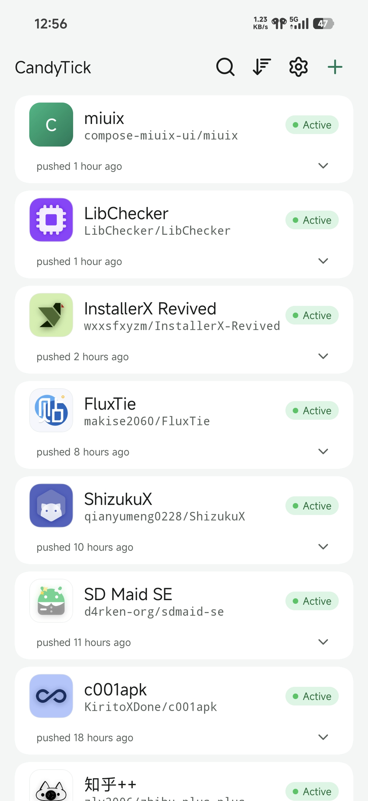
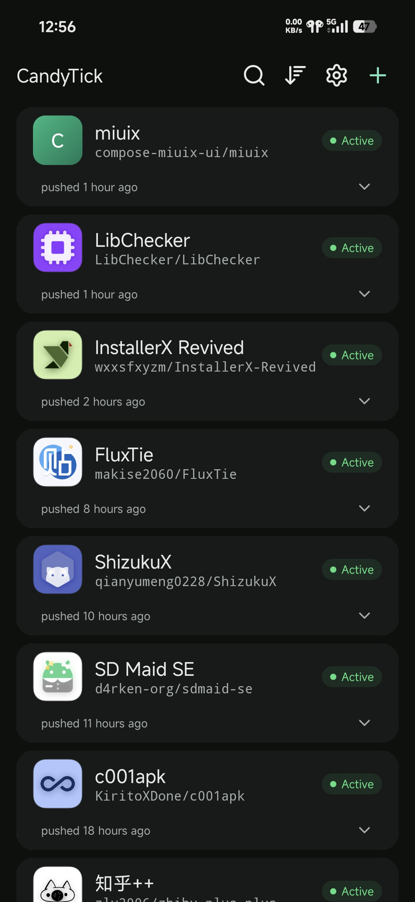

<div align="center">

# CandyTick

Follow GitHub repositories on Android, browse commits and releases, and find updates for your installed apps.

**[Download APK](https://github.com/JeffioZ/CandyTick/releases/latest)** · [Release notes](https://github.com/JeffioZ/CandyTick/releases) · [简体中文](README.md)

Android 10+ · One APK for 32- and 64-bit ARM

</div>

## Follow your first repository

1. Tap **+** at the top right of the home screen. Paste a GitHub URL, enter a repository name such as `LibChecker/LibChecker`, or search by keyword.
2. Tap **Add repository** in the preview. You can follow public repositories without signing in.

<p align="center">
  <a href="docs/fastlane/metadata/android/en-US/images/phoneScreenshots/1.png"></a>
  &ensp;
  <a href="docs/fastlane/metadata/android/en-US/images/phoneScreenshots/2.png"></a>
</p>

## Keep up with repositories

These features describe the main branch. See [unreleased changes](CHANGELOG.md#未发布) for what’s coming in the next release.

- **Browse commits and releases.** Switch branches to see their commits. Release notes support tables, code blocks, task lists, and links to GitHub issues. Open long notes on GitHub to read them in full.
- **Organize your home screen.** Search, pin, or remove repositories. You can undo a removal. Sort by recent activity, available updates, activity level, date added, or repository name. Tap the selected option again to reverse the order.
- **See how active a project is.** Activity levels reflect the time since the last push. Archived repositories have their own label.
- **Sync repositories.** Sync when the app opens or on a schedule. You can limit automatic sync to unmetered networks. Manual refresh also works on mobile data.
- **Read update notifications.** Tap an APK notification for a single repository to open that release. This clears only its unread marker. Update availability still depends on the version installed on your device.

## Update an installed app

CandyTick tries to match each repository to an app on your device. You can also choose one yourself. Once linked, the repository shows the app’s name and how its installed version compares with the release. CandyTick recognizes common version numbers, date-based versions, and prereleases. If it can’t compare two versions, it says so.

When a release has several packages, CandyTick recommends ones that match your device’s architecture. You can track or cancel a download and choose to open the installer when the download finishes. Standard APKs use the system installer. APKS, XAPK, and APKM bundles need a compatible third-party installer.

## Settings and backups

- **Back up subscriptions.** Export your subscriptions and cached repository details to JSON. Importing skips repositories you already follow. Backups exclude personal settings, GitHub tokens, and downloaded packages.
- **Free up space.** Clear downloaded packages or crash logs in Settings.
- **GitHub token.** If you often hit GitHub’s request limit, add a token in Settings to raise your [API rate limit](https://docs.github.com/en/rest/using-the-rest-api/rate-limits-for-the-rest-api).
- **Update CandyTick.** CandyTick can check for its own updates automatically. Enable automatic downloads to get them over Wi-Fi or mobile data. With **Open installer after download** enabled, CandyTick can install its own updates without a prompt when Android allows it.
- **Language and appearance.** Choose English or Simplified Chinese and a light or dark theme. The layout supports tablets, foldables, and landscape orientation.

## Build from source

Release builds use JDK 21. See the [app build configuration](app/build.gradle.kts) for the required Android SDK platform. Run the following command from the project root to build a debug APK.

```sh
bash gradlew assembleDebug
```

In Windows PowerShell, run `.\gradlew.bat assembleDebug`. The APK is written to `app/build/outputs/apk/debug/app-debug.apk`.

CandyTick uses Kotlin, Jetpack Compose, [Miuix](https://github.com/compose-miuix-ui/miuix), Navigation 3, OkHttp, and WorkManager. It renders release notes with [commonmark-java](https://github.com/commonmark/commonmark-java) and stores subscriptions locally as JSON.

## License and credits

CandyTick is licensed under [GPL-3.0](LICENSE). [Obtainium](https://github.com/ImranR98/Obtainium) inspired the version comparison and package selection. Interface icons come from [Lucide](https://lucide.dev). The app includes the [Lucide and Feather license notices](app/src/main/assets/licenses/lucide.txt).
