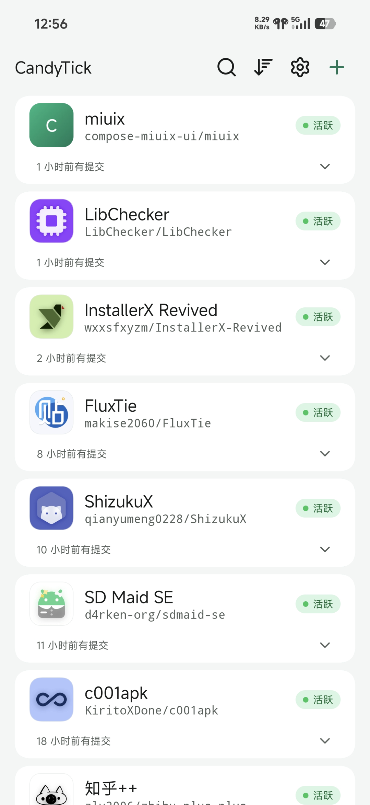

简体中文 | [English](README.en.md)

<div align="center">

# CandyTick

**GitHub 仓库维护状态追踪与新版本安装**
*Track repo health & updates*

[](LICENSE)
[](https://github.com/JeffioZ/CandyTick/stargazers)


订阅 GitHub 仓库，跟踪维护状态；有新版本时可以下载安装。

[](https://github.com/JeffioZ/CandyTick/releases)

</div>

<p align="center">
  
  
</p>

## 功能

### 追踪

- 按最近推送时间显示活跃程度，分为活跃、活跃度一般、较少更新和久未更新。已归档的仓库单独标记。
- 提交历史与版本历史，提交可切换分支查看
- 打开应用时或按设定周期同步，可限制自动同步使用非计费网络。点新版安装包通知可直达对应版本，阅读后只清除该版本的未读标记
- 搜索、排序、置顶、删除（可撤销）

### 版本与安装

- 更新日志支持 Markdown 表格、代码块、任务列表和可点击的 Issue 引用；长日志提供预览和完整原文入口
- 关联本机应用后自动比对版本，标题跟随应用名；已装的对应应用会自动识别
- 版本比较支持常见格式（x.y.z、日期式、预发布版），比不了的会直接说明
- 下载时可查看进度或取消，也可以设置为下载完成后自动打开安装程序
- 多安装包时按设备架构推荐候选。标准 APK 可交给系统安装器，APKS / XAPK / APKM 需要支持相应格式的第三方安装器

### 数据与体验

- 无需注册，可选 GitHub Token 提高限额（60 → 5000 次/小时）
- 订阅可导出、合并导入
- 清理已下载的安装包与崩溃日志
- 应用自身更新支持自动检查和下载，系统允许时可免确认安装
- 深浅色主题、中英双语；适配平板与折叠屏（内容列限宽，横竖屏自由）

## 构建

JDK 17+：

```bash
bash gradlew assembleDebug
```

Windows PowerShell 下运行 `.\gradlew.bat assembleDebug`。

## 技术栈

Kotlin · Compose + [Miuix](https://github.com/compose-miuix-ui/miuix) · Navigation 3 · OkHttp · WorkManager · [commonmark-java](https://github.com/commonmark/commonmark-java)（Markdown 解析）· 单 JSON 状态文件（无 Room / 无 KSP）

## 许可

[GPL-3.0](LICENSE) · 版本比较与 APK 选择的思路参考了 [Obtainium](https://github.com/ImranR98/Obtainium) · UI 图标取自 [Lucide](https://lucide.dev)，[随包许可](app/src/main/assets/licenses/lucide.txt)包含 Lucide 和 Feather 的署名。
