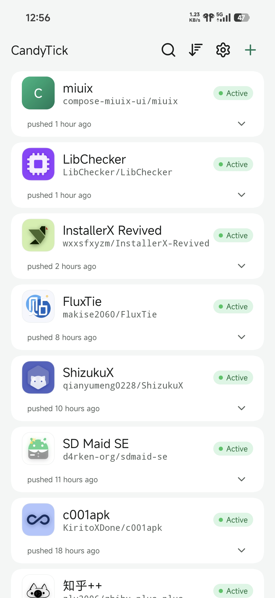

<div align="center">

# CandyTick

<p><strong>在 Android 上订阅 GitHub 仓库，跟进提交和版本发布，为已安装的应用查找更新。</strong></p>

<p>无需登录即可订阅公开仓库，按分支浏览提交记录，<br>阅读发布说明，并在新版本发布时收到提醒。</p>

<p>
  <a href="https://github.com/JeffioZ/CandyTick/releases/latest"></a>
  <a href="https://github.com/JeffioZ/CandyTick/releases"></a>
  
  <a href="LICENSE"></a>
  <a href="https://github.com/JeffioZ/CandyTick/stargazers"></a>
</p>

<p>
  <a href="https://github.com/JeffioZ/CandyTick/releases/latest"></a>
</p>

<p><a href="README.en.md">English</a></p>

</div>

> **系统要求：** Android 10（API 29）及以上。约 2 MB 通用 ARM 安装包，兼容绝大多数 Android 手机与平板。

## 🏠 首页

<p align="center"><sub>订阅的仓库以卡片呈现，刷新与阅读时保持当前位置不跳屏。<br>
支持按最近推送、可用更新、活跃程度等五种方式排序，均可反向排列。</sub></p>

<p align="center">
  <a href="docs/fastlane/metadata/android/zh-CN/images/phoneScreenshots/1.png"></a>
  &ensp;
  <a href="docs/fastlane/metadata/android/zh-CN/images/phoneScreenshots/2.png"></a>
</p>

## ✨ 功能一览

<table>
  <thead>
    <tr>
      <th width="130" align="left">功能</th>
      <th align="left">说明</th>
    </tr>
  </thead>
  <tbody>
    <tr>
      <td>📬&nbsp;<b>订阅仓库</b></td>
      <td>粘贴链接、输入仓库名或按关键词搜索，无需登录 GitHub 账号。</td>
    </tr>
    <tr>
      <td>📜&nbsp;<b>浏览动态</b></td>
      <td>按分支查看提交记录，在版本历史中阅读 Markdown 发布说明，<code>#123</code> 编号可直达 Issue。</td>
    </tr>
    <tr>
      <td>📲&nbsp;<b>更新应用</b></td>
      <td>自动识别仓库对应的本机应用并对比版本；多安装包时按设备架构推荐合适版本，应用自身也支持一键检查并更新。</td>
    </tr>
    <tr>
      <td>🔔&nbsp;<b>更新提醒</b></td>
      <td>后台定期同步，发现新版安装包时及时通知；可设为使用移动数据时暂停自动同步。</td>
    </tr>
    <tr>
      <td>📌&nbsp;<b>整理订阅</b></td>
      <td>置顶常看仓库、按名称搜索、五种排序方式自由切换，滑删后支持撤销。</td>
    </tr>
    <tr>
      <td>💾&nbsp;<b>备份迁移</b></td>
      <td>支持将订阅保存为本地 JSON 文件、复制到剪贴板或直接分享；导入时自动跳过已订阅仓库。</td>
    </tr>
    <tr>
      <td>🎨&nbsp;<b>外观语言</b></td>
      <td>支持浅色 / 深色 / 跟随系统、三套可切换桌面图标与中英文切换。</td>
    </tr>
  </tbody>
</table>

CandyTick 无需注册，安装包约 2 MB，订阅保存在手机上。匿名调用 GitHub API 时，每小时最多可发起 60 次请求。在设置中添加 [GitHub 令牌](https://docs.github.com/zh/rest/using-the-rest-api/rate-limits-for-the-rest-api) 后，限额通常可提高到每小时 5,000 次。

检查本机应用更新时，CandyTick 会把待检查应用的包名发给你启用的在线商店。部分商店还会收到应用版本、手机型号等信息。使用 F-Droid 或 IzzyOnDroid 时，CandyTick 会下载应用目录，在手机上比对版本。

在公开或私有仓库中使用在线翻译时，CandyTick 会把需要翻译的文字发给 Google 翻译。如果 Google 翻译不可用，可能会改用 MyMemory。

## 🚀 快速上手

1. 从 [Releases](https://github.com/JeffioZ/CandyTick/releases/latest) 下载 APK 并安装。
2. 点首页右上角的 **＋**，粘贴 GitHub 仓库链接（如 `JeffioZ/CandyTick`），或输入仓库名、按关键词搜索。
3. 确认预览中的仓库信息，点 **添加仓库**。

想跟进某个应用的更新？添加它的 GitHub 仓库，CandyTick 会自动关联同名应用，有新版时提醒你。

## 📚 更多

- 📝 [更新日志](CHANGELOG.md) — 每个版本的全部变化，附英文摘要
- 🔨 [从源码构建](#从源码构建) — JDK 21 + Android SDK，一条命令构建调试包

## 🔨 从源码构建

发布构建使用 JDK 21，所需 Android SDK 平台见[应用构建配置](app/build.gradle.kts)。想体验主分支最新改动，可在项目根目录直接构建调试包：

```sh
bash gradlew assembleDebug
```

在 Windows PowerShell 中运行 `.\gradlew.bat assembleDebug`。调试包生成在 `app/build/outputs/apk/debug/app-debug.apk`。

## 🤝 致谢

CandyTick 的界面使用 [Miuix](https://github.com/compose-miuix-ui/miuix) 和 [Phosphor 图标](https://phosphoricons.com)。版本比较和安装包选择参考了 [Obtainium](https://github.com/ImranR98/Obtainium)。

## 📄 许可证

[GPL-3.0](LICENSE)
